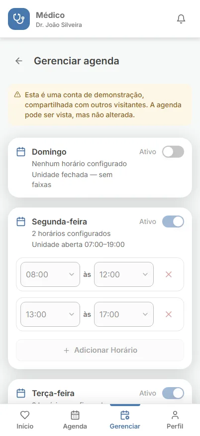
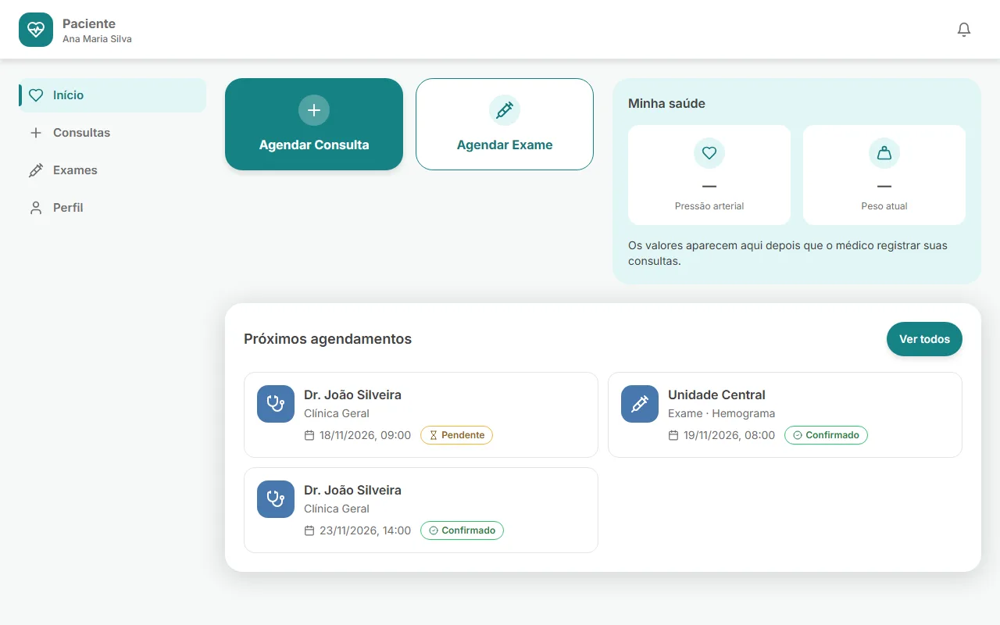
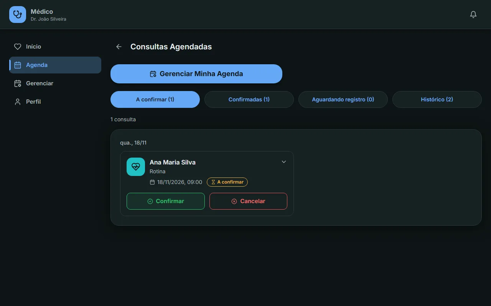

# Saúde+ Web

[](https://github.com/Plovatto/SaudeMais/actions/workflows/ci.yml)
[](https://github.com/Plovatto/SaudeMais/security/code-scanning)
[](https://scorecard.dev/viewer/?uri=github.com/Plovatto/SaudeMais)
[](https://github.com/Plovatto/SaudeMais/actions/workflows/pages.yml)
[](LICENSE)
[](https://nodejs.org/)

Interface do Saúde+, uma SPA desenvolvida com React, TypeScript e Vite para agendamento de consultas e exames, com áreas para paciente, médico e administrador.

**Acesse o app:** https://plovatto.github.io/SaudeMais/ · **API:** https://p01--saudemais--pgj2h2jjxzb4.code.run/docs/

<table>
  <tr>
    <td width="25%"></td>
    <td width="25%"></td>
    <td width="25%"></td>
    <td width="25%"></td>
  </tr>
  <tr>
    <td align="center"><em>Início do paciente</em></td>
    <td align="center"><em>Agendar consulta</em></td>
    <td align="center"><em>Início do médico</em></td>
    <td align="center"><em>Agenda semanal</em></td>
  </tr>
</table>

<table>
  <tr>
    <td width="50%"></td>
    <td width="50%"></td>
  </tr>
  <tr>
    <td align="center"><em>Layout para computador</em></td>
    <td align="center"><em>Tema escuro</em></td>
  </tr>
</table>

## Contas de demonstração

A tela de login mostra as contas abaixo, com um botão **Preencher**. Elas são compartilhadas e têm os dados restaurados todo dia.

| Perfil   | E-mail                    | Senha               |
| -------- | ------------------------- | ------------------- |
| Paciente | `paciente@saudemais.test` | `paciente-demo-123` |
| Médico   | `medico@saudemais.test`   | `medico-demo-123`   |

## Funcionalidades

- SPA criada com React e Vite, organizada por domínios da aplicação
- Paciente: agenda consultas e exames só em horários livres, reagenda, cancela, filtra o histórico e vê resultados de exame com impressão
- Médico: confirma pedidos, conclui com pressão e peso, registra falta e define a agenda semanal
- Administrador: usuários e perfis, catálogo, política de agendamento, integrações e relatórios
- Notificações com contador de não lidas, consultado só com a aba visível
- Tema claro e escuro, cor própria por perfil e layout para celular e computador
- Acessibilidade com alvo WCAG 2.2 AA, verificada com axe nos testes ponta a ponta
- Tipos da API gerados a partir do contrato OpenAPI
- Aliases de importação configurados no Vite

## Tecnologias

- [React](https://react.dev/) 19
- [TypeScript](https://www.typescriptlang.org/)
- [Vite](https://vite.dev/)
- [Tailwind CSS](https://tailwindcss.com/) 4
- [React Router](https://reactrouter.com/)
- [TanStack Query](https://tanstack.com/query) - cache e sincronização com a API
- [React Hook Form](https://react-hook-form.com/) e [Zod](https://zod.dev/) - formulários e validação
- [openapi-typescript](https://openapi-ts.dev/) - tipos gerados a partir do contrato da API
- [React Icons](https://react-icons.github.io/react-icons/)
- ESLint e Prettier - análise e padronização do código
- [Vitest](https://vitest.dev/) e [Testing Library](https://testing-library.com/) - testes unitários e de componentes
- [Playwright](https://playwright.dev/) e [axe](https://github.com/dequelabs/axe-core) - testes ponta a ponta e de acessibilidade

## Como Executar

### Pré-requisitos

Antes de começar, tenha instalado:

- [Node.js](https://nodejs.org/) 22.22.2+, 24.15+ ou 26+
- npm

Para testar a integração completa, mantenha também a [Saúde+ API](https://github.com/Plovatto/API-SaudeMais) em execução.

### Instalação

Clone o repositório:

```bash
git clone https://github.com/Plovatto/SaudeMais.git
```

Acesse a pasta do projeto:

```bash
cd SaudeMais
```

Instale as dependências:

```bash
npm install
```

Crie o arquivo de variáveis de ambiente:

```bash
cp .env.example .env
```

Execute o servidor de desenvolvimento:

```bash
npm run dev
```

O projeto estará disponível em:

```text
http://localhost:5173
```

## Variáveis de Ambiente

As variáveis são definidas no arquivo `.env`, que não deve ser versionado.

Utilize `.env.example` como referência:

```env
VITE_API_URL=http://localhost:3001
```

O build falha se `VITE_API_URL` faltar ou for inválida. Como toda variável `VITE_`, ela fica visível no código publicado, então nunca coloque segredos nela.

## Deploy

O deploy é feito no GitHub Pages pelo workflow `.github/workflows/pages.yml`, disparado a cada push na branch `main`.

Duas configurações são necessárias no repositório:

- Em **Settings → Pages**, a origem deve estar como **GitHub Actions**.
- Em **Settings → Secrets and variables → Actions → Variables**, `VITE_API_URL` deve apontar para a API publicada, com `https`.

O build usa `/SaudeMais/` como caminho base, copia `index.html` para `404.html` para que links diretos funcionem e injeta uma Content Security Policy que só permite chamadas para a API.

A origem `https://plovatto.github.io` também precisa constar em `CORS_ORIGIN` na API.

## Scripts

| Comando                | Descrição                                                 |
| ---------------------- | --------------------------------------------------------- |
| `npm run dev`          | Inicia o servidor de desenvolvimento                      |
| `npm run build`        | Executa a checagem de tipos e gera o build de produção    |
| `npm run preview`      | Serve localmente o build de produção (rode `build` antes) |
| `npm run typecheck`    | Executa a checagem de tipos sem gerar arquivos            |
| `npm run lint`         | Executa a análise do código com ESLint                    |
| `npm run lint:fix`     | Corrige problemas de lint automaticamente                 |
| `npm run format`       | Formata o código com Prettier                             |
| `npm run format:check` | Confere a formatação                                      |
| `npm test`             | Executa os testes                                         |
| `npm run test:watch`   | Executa os testes em modo de observação                   |
| `npm run api:types`    | Gera os tipos a partir do contrato da API                 |
| `npm run e2e`          | Executa os testes ponta a ponta                           |
| `npm run e2e:ui`       | Abre os testes ponta a ponta no modo UI do Playwright     |

Para rodar os testes ponta a ponta localmente, veja o [guia de contribuição](CONTRIBUTING.md#testes-ponta-a-ponta).

## Estrutura do Projeto

```text
src/
├── app/              # Componente raiz, rotas e guards de sessão e perfil
├── components/       # Componentes reutilizáveis (ui, layout, agendamentos, formulários...)
├── config/           # Variáveis de ambiente validadas e CSP do build
├── constants/        # Áreas, páginas e navegação de cada perfil
├── features/         # Uma pasta por tela ou domínio (patient-home, book-exam, doctor-agenda...)
├── hooks/            # Hooks reutilizáveis entre features
├── lib/              # Cliente da API, sessão, datas, tema e textos em pt-BR
├── styles/           # CSS global e tokens de design
├── test/             # Configuração dos testes
└── main.tsx

e2e/                  # Testes ponta a ponta com Playwright e axe
```

## Licença

Distribuído sob a licença MIT. Veja [LICENSE](LICENSE).
