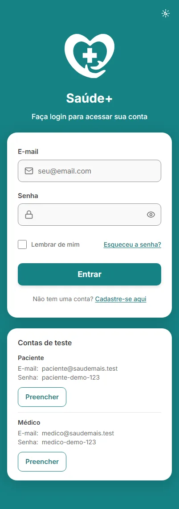
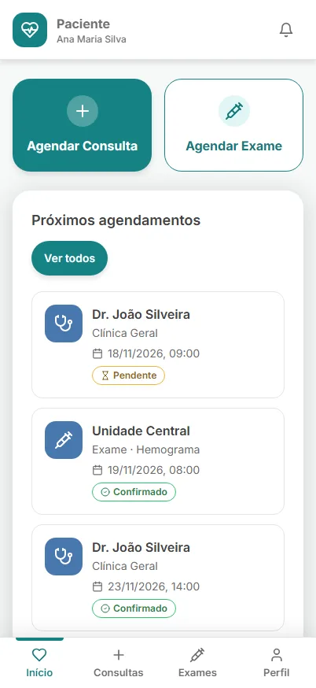
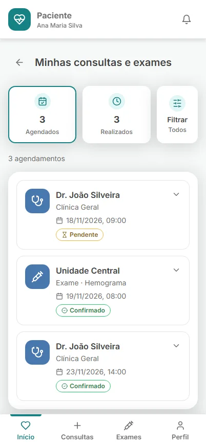
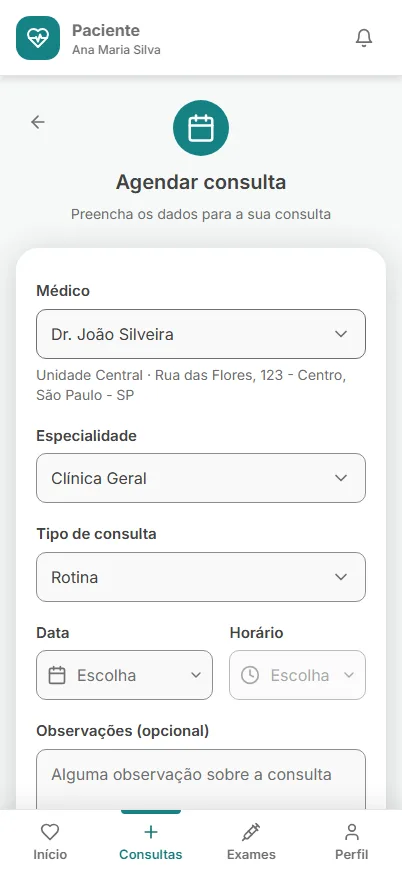
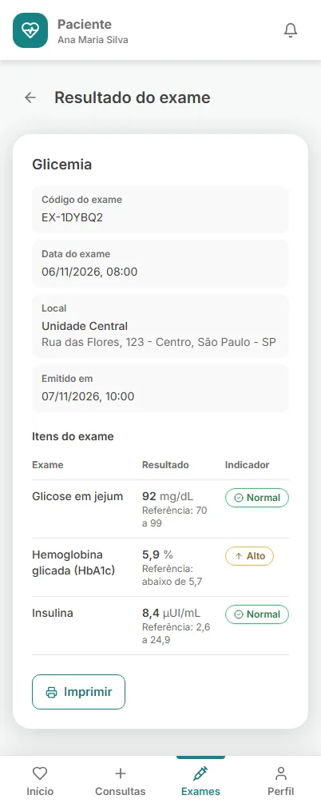
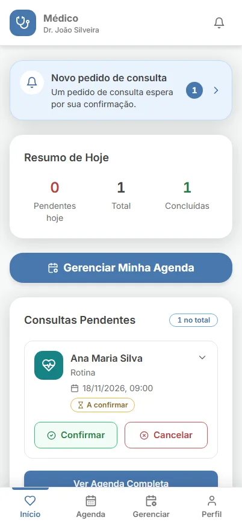

# Saúde+ Web

[](https://github.com/Plovatto/SaudeMais/actions/workflows/ci.yml)
[](https://github.com/Plovatto/SaudeMais/actions/workflows/pages.yml)
[](https://scorecard.dev/viewer/?uri=github.com/Plovatto/SaudeMais)
[](LICENSE)
[](https://nodejs.org/)

Interface do Saúde+, um sistema de agendamento de consultas e exames com três perfis: o **paciente** agenda consultas e exames, acompanha o histórico, vê os resultados e recebe avisos; o **médico** define a agenda semanal, confirma pedidos e registra a conclusão ou a falta, com pressão e peso; o **administrador** cuida de usuários, perfis, catálogo, política de agendamento, integrações e relatórios. É um projeto de portfólio, com React 19, TypeScript, Vite e Tailwind CSS, fiel ao desenho do Figma no celular e com layout próprio a partir de 1024 px.

|                                    |                                                                     |
| ---------------------------------- | ------------------------------------------------------------------- |
| **Aplicação no ar**                | https://plovatto.github.io/SaudeMais/                               |
| **Repositório da API**             | [Plovatto/API-SaudeMais](https://github.com/Plovatto/API-SaudeMais) |
| **Documentação interativa da API** | https://p01--saudemais--pgj2h2jjxzb4.code.run/docs/                 |
| **Quadro do projeto**              | [Saúde+](https://github.com/users/Plovatto/projects/2)              |

**Sumário:** [Contas de demonstração](#contas-de-demonstração) · [Telas](#telas) · [Funcionalidades](#funcionalidades) · [Decisões técnicas](#decisões-técnicas) · [Arquitetura](#arquitetura) · [Como executar](#como-executar-localmente) · [Testes ponta a ponta](#testes-ponta-a-ponta) · [Deploy](#deploy) · [Desvios do Figma](#desvios-do-figma) · [Fluxo de trabalho](#fluxo-de-trabalho)

## Contas de demonstração

A tela de login mostra as duas contas, com um botão **Preencher** para cada uma:

| Perfil   | E-mail                    | Senha               |
| -------- | ------------------------- | ------------------- |
| Paciente | `paciente@saudemais.test` | `paciente-demo-123` |
| Médico   | `medico@saudemais.test`   | `medico-demo-123`   |

A conta de médico também é paciente e por isso passa pela tela "Escolha seu perfil". As duas são compartilhadas com outros visitantes: dados pessoais, senha, agenda semanal e leitura de notificações não podem ser alterados, e a API restaura os dados todo dia. Não há conta pública de administrador. O primeiro administrador é criado pela API a partir de variáveis de ambiente.

## Telas

Capturas do site publicado, com as contas de demonstração, no tamanho do Figma (402 px de largura).

**Paciente**

| Login                                                                                                                                                                             | Início                                                                                                                                                                                                         | Agendamentos                                                                                                                                                                   | Agendar consulta                                                                                                                                                                                   | Resultado do exame                                                                                                                                                                                                                  |
| --------------------------------------------------------------------------------------------------------------------------------------------------------------------------------- | -------------------------------------------------------------------------------------------------------------------------------------------------------------------------------------------------------------- | ------------------------------------------------------------------------------------------------------------------------------------------------------------------------------ | -------------------------------------------------------------------------------------------------------------------------------------------------------------------------------------------------- | ----------------------------------------------------------------------------------------------------------------------------------------------------------------------------------------------------------------------------------- |
|  |  |  |  |  |

O resultado do exame usa valores de exemplo: o paciente de demonstração ainda não tinha resultado publicado no momento da captura.

**Médico**

| Início                                                                                                                                                                                                  | Gerenciar agenda                                                                                                                                                                             |
| ------------------------------------------------------------------------------------------------------------------------------------------------------------------------------------------------------- | -------------------------------------------------------------------------------------------------------------------------------------------------------------------------------------------- |
|  |  |

No computador, menu lateral, listas em duas colunas e tema escuro:


## Funcionalidades

- **Conta:** cadastro com aceite dos termos, login com "Lembrar de mim", recuperação de senha por e-mail, troca de perfil, perfil com dados pessoais, troca de senha e sessões ativas com "sair de todas"
- **Paciente:** agenda consultas (médico, especialidade, tipo de consulta, data e horário só com vagas livres) e exames (tipo, unidade com lugares restantes, data e horário); acompanha agendados e realizados com filtro por tipo e status; reagenda e cancela conforme a política; vê o resultado do exame com histórico de versões e imprime; vê pressão e peso registrados pelo médico
- **Médico:** início com pedidos novos, resumo do dia e consultas aguardando registro; agenda com as abas A confirmar, Confirmadas, Aguardando registro e Histórico; confirma, cancela com motivo, conclui com pressão e peso ou marca falta; define a agenda semanal em faixas; vê os resultados de exame de um paciente com consulta de avaliação de exames recente
- **Administrador:** painel com contagens; usuários com busca, filtros, edição, link de redefinição de senha, desativação e reativação, perfil de médico e de administrador; configurações de especialidades, unidades (horários e exames oferecidos), tipos de exame, política de agendamento e chaves de integração com o laboratório; relatórios por período com totais por situação e série diária ou semanal
- **Notificações:** sino com contador de não lidas, painel com as últimas, página paginada e "Marcar todas como lidas", separadas por perfil
- **Interface:** tema claro, escuro ou do sistema; cor própria para cada perfil; navegação inferior no celular e menu lateral a partir de 1024 px; telas de 404, 403 e erro de conexão; estados vazios e de carregamento em todas as listas

## Decisões técnicas

| Decisão                                             | Por quê                                                                                                                                                                                                                                                                                                                                                                                                                  |
| --------------------------------------------------- | ------------------------------------------------------------------------------------------------------------------------------------------------------------------------------------------------------------------------------------------------------------------------------------------------------------------------------------------------------------------------------------------------------------------------ |
| **React 19 + Vite 8 + Tailwind CSS 4**              | Mesma base dos projetos recentes do portfólio. O Vite dá build rápido e plugins simples para o que a hospedagem estática exige; o Tailwind 4 com `@theme` transforma as medidas do Figma em tokens, e o `prettier-plugin-tailwindcss` mantém as classes ordenadas                                                                                                                                                        |
| **React Router com rotas sob demanda**              | Cada tela é carregada só quando aberta, e o perfil da área (`/paciente`, `/medico`, `/admin`) vem da URL: duas abas em perfis diferentes não brigam por estado. Abas e filtros também ficam na URL (`?aba=`, `?tipo=`, `?status=`)                                                                                                                                                                                       |
| **TanStack Query**                                  | Cache por chave (`query-keys.ts`), com validade de 30 s nas listas, 10 min nos catálogos e zero na disponibilidade de horários. Cada mutação invalida o que mudou. Repetição automática só em leitura com erro de rede, tempo esgotado ou 5xx; 401 encerra a sessão em um único lugar                                                                                                                                    |
| **react-hook-form + Zod**                           | Validação no cliente com schemas Zod, mensagem por campo e foco no primeiro campo inválido. Os erros de campo que a API devolve em `fields` são aplicados no campo correspondente do formulário                                                                                                                                                                                                                          |
| **Tipos gerados do OpenAPI, com conferência no CI** | O front guarda uma cópia do contrato da API (`src/lib/api/openapi.json`) e gera `schema.d.ts` com `openapi-typescript`. O `fetch` próprio é tipado por rota e método, sem cliente extra. O CI gera os tipos de novo e falha se forem diferentes do que está versionado, sem depender de a API estar no ar                                                                                                                |
| **Token em `sessionStorage` e `BroadcastChannel`**  | Front e API ficam em sites diferentes, então não há cookie de sessão. O token fica em `sessionStorage` (ou em `localStorage` com "Lembrar de mim"), com memória como reserva quando o navegador bloqueia o armazenamento. Sair em uma aba encerra as outras pelo `BroadcastChannel`. Como `plovatto.github.io` é uma origem compartilhada, a proteção vem da validade curta, das sessões revogáveis e do "sair de todas" |
| **CSP por meta tag**                                | O GitHub Pages não permite cabeçalhos próprios. O build injeta uma Content Security Policy que só aceita scripts, estilos e fontes do próprio site e chamadas para a origem da API. As fontes são servidas pelo site, sem CDN. Como `frame-ancestors` não funciona em meta tag, o `theme-init.js` esconde a página quando ela é carregada dentro de um frame                                                             |
| **GitHub Pages com `404.html`**                     | O build copia `index.html` para `404.html`, então um link direto para qualquer rota abre a aplicação. O caminho base `/SaudeMais/` vale no build e no `preview`, e o build recusa uma `VITE_API_URL` ausente ou sem `https` (salvo `localhost`, para os testes) em vez de publicar uma página em branco                                                                                                                  |
| **Fuso de São Paulo**                               | O front nunca monta um instante: devolve à API o `startsAt` que recebeu na lista de vagas. Datas civis trocadas com a API são de São Paulo, e toda exibição usa `Intl` com `timeZone: 'America/Sao_Paulo'`, inclusive "Hoje" e "há 2 h". Os testes de datas rodam com o processo em Tóquio e em Los Angeles                                                                                                              |
| **Acessibilidade WCAG 2.2 AA**                      | Diálogos com `<dialog>` nativo, menus com setas e Esc, cartões expansíveis com `aria-expanded`, status com texto e ícone, alvos de toque de 44 px, foco visível, `prefers-reduced-motion`, título por rota e link "Pular para o conteúdo". Onde a cor do Figma não chegava a 4,5:1, um tom mais escuro da mesma cor é usado só naquela superfície                                                                        |
| **Tema claro e escuro por perfil**                  | Tokens por perfil (`data-role`) e por tema (`data-theme`): turquesa para paciente, azul para médico e cinza para administrador, cada um com a versão escura em contraste AA. O tema segue o sistema por padrão, pode ser trocado no menu de conta e nas telas públicas e é aplicado antes da primeira pintura, sem piscar                                                                                                |
| **Catálogo de erros por código**                    | A API responde `{ message, code, fields? }`. O texto mostrado vem do `code` (`src/lib/messages/errors.pt-BR.ts`), com a `message` da API como reserva para códigos novos. Textos e notificações ficam centralizados em pt-BR, prontos para outro idioma                                                                                                                                                                  |

## Arquitetura

```text
src/
  app/          componente raiz, rotas e guards de sessão e perfil
  components/
    ui/         componentes base (botões, campos, diálogos, menus, abas, paginação, toasts)
    layout/     layouts, cabeçalho, navegação, menu da conta e títulos
    bookings/   cartões e diálogos de agendamento usados por paciente e médico
    booking-form/ formulário de agendamento e de reagendamento comum a consultas e exames
    exam-results/ visualização de resultado, usada pelo paciente e pelo médico
    forms/        campos de dados pessoais e de nova senha
    notifications/ faixa da última notificação, no início do paciente e do médico
  config/       variáveis de ambiente validadas e CSP do build
  constants/    áreas, páginas e navegação de cada perfil, contas de demonstração
  features/     uma pasta por tela ou domínio (patient-home, book-exam, doctor-agenda, admin-users...)
  hooks/        hooks compartilhados (parâmetros da URL, listas com abas, catálogos)
  lib/          datas, tema, cliente do TanStack Query, chaves de cache e telefone
    api/        contrato OpenAPI, tipos gerados, fetch tipado e erros da API
    auth/       token, sessão entre abas e retorno após o login
    messages/   textos de erro e de notificação em pt-BR
    validation/ regras de campo reaproveitadas pelos schemas
  styles/       CSS global e tokens de design
  test/         configuração dos testes
public/
  theme-init.js tema antes da primeira pintura e proteção contra frames
e2e/            testes ponta a ponta com Playwright e axe
```

- Uma feature não importa outra. O que duas features usam sobe para `components`, `hooks` ou `lib`, e só `app` conhece as features, para montar as rotas.
- Cada feature expõe o que as rotas usam pelo próprio `index.ts` e tem um `*-api.ts` com as chamadas dela.
- Cada pasta de `src` tem um alias de importação (`@app`, `@components`, `@config`, `@constants`, `@features`, `@hooks`, `@lib`).
- Os testes ficam ao lado do código: unidade com Vitest e componentes com Testing Library em jsdom. Os ponta a ponta ficam em `e2e/`.

## Como executar localmente

**Pré-requisitos:** [Node.js](https://nodejs.org/) 22.22.2+, 24.15+ ou 26+, npm e a [API do Saúde+](https://github.com/Plovatto/API-SaudeMais) rodando localmente (ou o endereço da API publicada).

```bash
git clone https://github.com/Plovatto/SaudeMais.git
cd SaudeMais
npm install
cp .env.example .env
npm run dev
```

A aplicação fica em `http://localhost:5173`.

O `.env` não é versionado; o `.env.example` traz o valor para a API local:

```env
VITE_API_URL=http://localhost:3001
```

`VITE_API_URL` é o endereço da API, com `http` ou `https`, sem query string nem fragmento. O build é recusado se ela faltar ou for inválida, e o build de produção exige `https`, salvo para uma API em `localhost`, `127.0.0.1` ou `[::1]`. Como toda variável `VITE_`, ela fica visível no código publicado; nunca coloque segredos nela. A API precisa aceitar a origem do front no CORS.

| Script                                    | Descrição                                                             |
| ----------------------------------------- | --------------------------------------------------------------------- |
| `npm run dev`                             | Inicia em modo de desenvolvimento                                     |
| `npm run build`                           | Verifica os tipos e gera a versão de produção em `dist/`              |
| `npm run preview`                         | Serve localmente a versão de produção, em `/SaudeMais/`               |
| `npm run typecheck`                       | Verifica os tipos                                                     |
| `npm run lint` / `npm run lint:fix`       | Analisa o código com ESLint / corrige o que for automático            |
| `npm run format` / `npm run format:check` | Formata com Prettier / confere a formatação                           |
| `npm test` / `npm run test:watch`         | Roda os testes / em modo observação                                   |
| `npm run api:types`                       | Gera `src/lib/api/schema.d.ts` a partir de `src/lib/api/openapi.json` |
| `npm run e2e` / `npm run e2e:ui`          | Roda os testes ponta a ponta / no modo UI do Playwright               |

Quando a API mudar, atualize `src/lib/api/openapi.json` a partir de `/docs/openapi.json` da API publicada e rode `npm run api:types` no mesmo PR que usa a mudança.

### Testes ponta a ponta

Os testes em `e2e/` usam [Playwright](https://playwright.dev/) e [axe](https://github.com/dequelabs/axe-core) e cobrem três fluxos: cadastro e agendamento; confirmação pelo médico e notificação ao paciente; o Admin torna um usuário médico e a vaga aparece para o paciente. Cada fluxo roda no Chromium e no WebKit, em 402 px e em 1280 px, e falha se o axe encontrar violação séria ou crítica.

Eles precisam da [API](https://github.com/Plovatto/API-SaudeMais) rodando em `http://localhost:3001` com um banco descartável, nunca o de produção. Na pasta da API, com o `.env` apontando para esse banco:

```env
NODE_ENV=development
CORS_ORIGIN=http://localhost:4173
APP_PUBLIC_URL=http://localhost:4173/SaudeMais
MAIL_DRIVER=console
DEMO_ACCOUNTS_ENABLED=true
ADMIN_EMAIL=admin@e2e.test
ADMIN_PASSWORD=uma-senha-de-teste-longa
```

```bash
npm run db:seed
npm run dev
```

Aqui, instale os navegadores uma vez e rode os testes com as mesmas credenciais do Admin:

```bash
npx playwright install chromium webkit
ADMIN_EMAIL=admin@e2e.test ADMIN_PASSWORD=uma-senha-de-teste-longa npm run e2e
```

O Playwright gera o build com `VITE_API_URL=http://localhost:3001` e o serve com `vite preview` em `http://localhost:4173/SaudeMais/`. Os testes recusam uma API fora desta máquina.

A API limita cadastros a 10 por hora por IP e logins a 30 a cada 15 minutos por IP. Cada rodada cria 8 contas e faz cerca de 14 logins, por isso os testes não repetem em caso de falha; para rodar de novo antes do fim da janela, reinicie a API, que guarda os limites na memória.

No CI, o workflow `E2E` sobe a API no commit fixado em `API_REF` (ou no informado ao disparar o workflow manualmente) contra um PostgreSQL 18 temporário. Quando algo falha, o relatório e os traces ficam disponíveis por 3 dias; eles podem conter as credenciais descartáveis da execução, nunca dados reais.

## Deploy

Cada merge na `main` publica o site no GitHub Pages pelo workflow [Pages](.github/workflows/pages.yml): confere que `VITE_API_URL` usa `https`, instala as dependências, roda lint, testes e build com Node 26 e publica `dist/`. `VITE_API_URL` vem da variável de mesmo nome do repositório (Settings → Secrets and variables → Actions → Variables). A API roda na Northflank e precisa aceitar `https://plovatto.github.io` no CORS.

## Desvios do Figma

O Figma tem 22 telas de celular (402 × 874) e nenhum layout de computador. As telas desenhadas seguem o Figma; as que ele só cita (perfil, recuperação de senha, termos, reagendamento, filtro, resultado do exame, administração e erros) reaproveitam os mesmos componentes. Os desvios:

- **Menu de conta** no ícone do cabeçalho (Meu perfil, Trocar perfil, tema, Sair), igual nos três perfis: sem ele o administrador, que não tem aba Perfil, não teria como sair.
- **Agendar consulta** ganha "Tipo de consulta" (primeira consulta, rotina, retorno, avaliação de exames). Médico e especialidade se filtram mutuamente, e data e horário listam só opções com vaga.
- **Agendar exame** traz a unidade logo depois do tipo de exame, antes da data: as vagas dependem do tipo e da unidade, então data e horário só são habilitados depois dos dois.
- **Agenda do médico** ganha Concluir e Não compareceu, a aba Aguardando registro e a aba Histórico; o início do médico ganha a seção "Aguardando registro".
- **Agendamentos realizados:** exame com resultado ganha o botão "Ver resultado", que abre o resultado com as versões anteriores e o layout de impressão (o navegador gera o PDF).
- **Editar usuário** perde os campos de senha e ganha "Enviar link de redefinição"; o e-mail é só leitura, porque o administrador nunca vê nem define senha.
- **Cadastro de médico** ganha UF e unidade, e o rótulo do registro muda com o conselho da especialidade (CRM, CRN, CRP...).
- **Gerenciar agenda** mostra os 7 dias da semana, com o horário de funcionamento da unidade em cada um.
- **Cores:** tom mais escuro da cor do perfil onde o texto não atingia 4,5:1, e versão escura de cada cor para o tema escuro.
- **Computador:** a partir de 1024 px, menu lateral, conteúdo de até 1040 px, listas em duas colunas e usuários em tabela.
- Erros de texto corrigidos ("às", "Dra.").

## Fluxo de trabalho

- **Quadro kanban:** o trabalho é planejado no [Project Saúde+](https://github.com/users/Plovatto/projects/2), compartilhado com a API, com um milestone por fase. Cada card é uma issue, que corresponde a uma branch (`feature/`, `fix/`, `docs/`...) e a um pull request com o modelo O que foi feito, Detalhes e Testes.
- **Commits:** [gitmoji](https://gitmoji.dev/) com [Conventional Commits](https://www.conventionalcommits.org/), em inglês e minúsculas.
- **CI em todo PR** ([ci.yml](.github/workflows/ci.yml)), em Node 22, 24 e 26: formatação, conferência dos tipos da API contra o contrato, lint, typecheck, testes, build, conferência da saída estática (`404.html` igual a `index.html`, CSP no início do `<head>`, caminho base) e `npm audit` das dependências de produção.
- **E2E em todo PR** ([e2e.yml](.github/workflows/e2e.yml)): os três fluxos ponta a ponta contra a API e um PostgreSQL temporários, como descrito em [Testes ponta a ponta](#testes-ponta-a-ponta).
- **Merge** só com CI verde, por merge commit, na `main` protegida. Actions fixadas por SHA, Dependabot e [OpenSSF Scorecard](https://scorecard.dev/viewer/?uri=github.com/Plovatto/SaudeMais).

Veja também o [guia de contribuição](CONTRIBUTING.md) e a [política de segurança](SECURITY.md).

## Licença

Distribuído sob a licença MIT. Veja [LICENSE](LICENSE).
